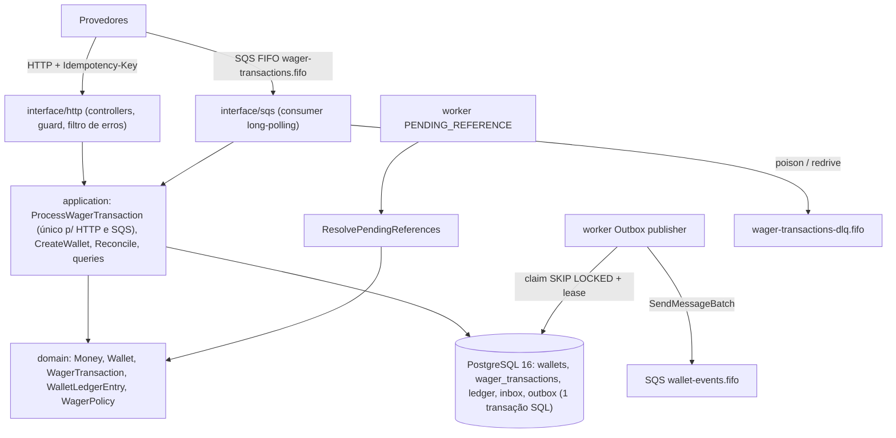
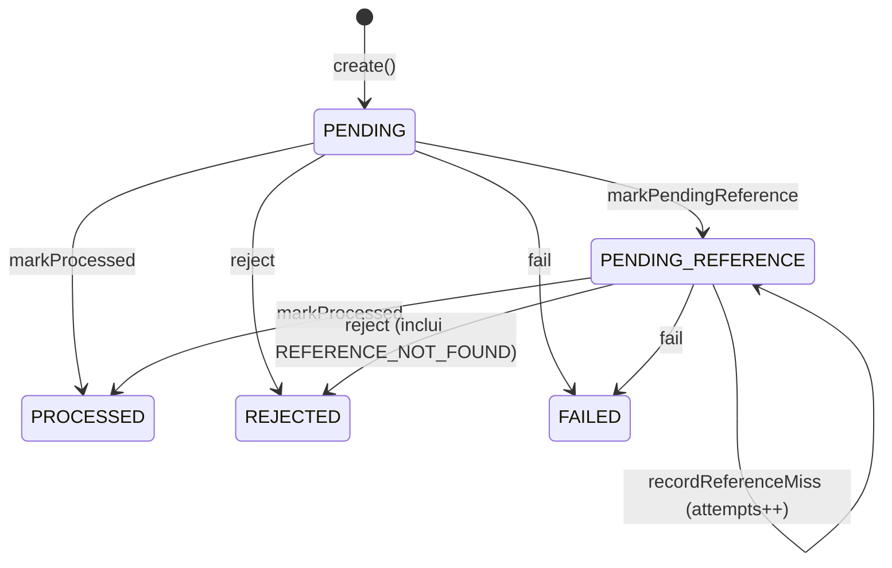

# ARCHITECTURE — Distributed Wagering Processor

Decisões, justificativas, trade-offs e limitações **do que foi construído**. O design detalhado que guiou a implementação está em [`docs/DESIGN.md`](docs/DESIGN.md), e os desvios, com o motivo de cada um, estão em [`docs/NOTES.md`](docs/NOTES.md).

## 1. Visão geral

- **Camadas** (regra de dependência verificada por teste em `tests/unit/architecture.test.ts`):
  - `domain` não importa framework nenhum (só `decimal.js`);
  - `application` não importa Nest, MikroORM, AWS, pino, zod nem jose;
  - `infrastructure` implementa as portas;
  - `interface` adapta HTTP, SQS e workers;
  - `bootstrap` faz a composição.
- **Use cases são classes TypeScript puras**, instanciadas por `useFactory` no Nest, e todo provider usa `@Inject(TOKEN)` explícito.
- **Toda instância roda os mesmos componentes**: HTTP, consumer, outbox publisher e worker de pendências, cada um ligável por env. A correção **nunca** depende de haver uma única instância: os testes sobem 3 processos reais.

## 2. ORM: MikroORM 7 com `EntitySchema` e migrations SQL manuais

**Decisão.** Usamos MikroORM (a opção preferencial do desafio) com `EntitySchema` sobre *records* planos. Não há decorators nem entidades do ORM no domínio. Mappers reconstroem o domínio via `rehydrate`. O schema vem **exclusivamente** de migrations SQL escritas à mão (`src/infrastructure/persistence/migrations/*`, com `up` e `down`, lista explícita e ordem fixa). O schema generator do ORM não é usado.

**Por quê.**
- O enunciado pede que unicidade, imutabilidade e não-negatividade morem **no schema**. CHECKs compostos, FKs compostas, índice único parcial, triggers append-only e o *constraint trigger* diferido não se expressam bem por metadata de ORM. Em SQL eles ficam explícitos e revisáveis.
- O domínio fica livre do ORM: `Money`, `Wallet` etc. têm construtor privado e factories (`create`, `open`, `rehydrate`), e o mapper é a única ponte.
- **Unit of Work explícita (`MikroUnitOfWork`).** Cada `run` faz `em.fork()` e abre uma transação (`em.transactional`). Os repositórios escrevem com `em.insert`, `em.nativeUpdate` e `em.execute`, e leem com `disableIdentityMap`. **Não** usamos `persist/flush` nem o identity map como fonte de verdade. Assim o momento de cada escrita é deliberado: a ordem de locks e de inserts importa para as FKs e para os triggers.
- TypeORM também seria aceito. Escolhemos MikroORM pelo `transactional()`/fork explícito e pelo `LockMode.PESSIMISTIC_WRITE`, que gera `SELECT … FOR UPDATE` (conferido no log de SQL).

## 3. `Money` e o mapeamento no banco

| Camada | Representação |
|---|---|
| Contrato (HTTP/SQS/eventos) | `{ "amount": "25.00", "currency": "BRL" }`: string decimal, **exatamente 2 casas** |
| Domínio | `Money` imutável sobre um `Decimal` (clone isolado de `decimal.js`, precisão 40, sem notação exponencial); toda operação devolve uma instância nova; moedas diferentes → `CurrencyMismatchError` |
| Banco | `NUMERIC(20,2)` + `CHAR(3)` em colunas separadas (`amount`/`balance` + `currency`) |
| Driver | o `pg` devolve `numeric` como **string**; leituras de relatório fazem `::text` no SQL. Nenhum valor monetário passa por `number` (o mapper recusa `number` explicitamente) |

- A entrada é validada por regex antes de construir o `Decimal`: `^(0|[1-9][0-9]{0,14})\.[0-9]{2}$`. Isso rejeita `NaN`, `Infinity`, `1e3`, `-1.00`, `1.005`, `25`, `01.00`, espaços e números JSON. A moeda segue `^[A-Z]{3}$`.
- Nenhuma operação arredonda: somas e subtrações de valores com escala 2 continuam com escala 2. Um `-0` serializa como `"0.00"`.
- `Money.fromSigned` existe só para reconstruir valores internos negativos, como a diferença da reconciliação. Não é contrato de entrada.
- O modelo é multi-moeda (a unicidade da wallet é `(player_id, currency)`, e há FK composta `(wallet_id, currency)` no ledger). Os testes usam BRL e cobrem o conflito de moeda.

## 4. Estratégia transacional

**Uma única transação SQL por operação de negócio**, em `READ COMMITTED`, cobrindo nesta ordem:

1. inbox (se SQS);
2. lock da wallet;
3. verificação de idempotência;
4. decisão de domínio;
5. insert da `wager_transaction`;
6. update da wallet com `version`;
7. insert do ledger;
8. *nudge* de pendências;
9. insert no outbox;
10. inbox `processed_at`.

Ou tudo é confirmado junto, ou nada é: o teste `process-wager.atomicity.test.ts` injeta falha depois do ledger e no outbox e verifica que **nada** persiste.

- `lock_timeout` (5 s) e `statement_timeout` (15 s) são definidos por transação (`set_config(..., true)`), para que uma wallet quente nunca prenda uma conexão indefinidamente.
- O **constraint trigger diferido** (`wallets_ledger_backed`) roda no `COMMIT` e recusa qualquer saldo que não seja o `balance_after` do último lançamento. É a última linha de defesa da invariante saldo ⇔ ledger.
- **Eventos nunca são publicados antes do commit.** O use case só grava no outbox, e só o publisher publica, depois, fora da transação.
- O reprocessamento é feito por `withTransientRetry`, que envolve a **execução inteira** (uma transação nova por tentativa) e só para erros seguros:
  - `40001`, `40P01`, `55P03`, `57014` e erros de conexão;
  - corridas de unicidade conhecidas (`IdempotencyRaceError` e as constraints de idempotência/reversão/inbox).

  São 3 tentativas com backoff de 25–200 ms + jitter. Esgotadas, a operação vira `TransientInfrastructureError` → HTTP 503 ou retry com backoff de visibilidade no SQS. A classificação usa o **SQLSTATE** (`err.code`), nunca `instanceof`: o MikroORM entrega `lock_timeout` como `DriverException` genérica.

## 5. Concorrência

**Decisão: lock pessimista por linha da wallet** (`SELECT … FOR UPDATE`) no início de toda transação que lê, decide e escreve, com `version` verificada no `UPDATE … WHERE id = ? AND version = ?` como defesa extra, e constraints/triggers como última linha.

- **Sem lock global.** O único lock de negócio é a linha da wallet afetada; wallets diferentes rodam em paralelo.
- **Por que não otimista:** na *hot wallet* (50 requisições simultâneas), o lock otimista gera N−1 conflitos por rodada, retries em cascata e falhas espúrias quando o limite de retry se esgota. O pessimista só serializa quem disputa a mesma linha.
- **Por que não `SERIALIZABLE`:** daria abortos por falso positivo sem ganho, já que todas as invariantes por wallet estão sob o mesmo lock.
- **Em `READ COMMITTED`**, depois de obter o lock, toda leitura seguinte vê os commits anteriores. Por isso a checagem de idempotência acontece **depois** do lock (ver §6).
- **Ordem de locks fixa** (inbox → wallet → transação → ledger/outbox), e uma transação trava **exatamente uma** wallet. Não há ciclo possível. Claims de outbox e de pendências são transações curtas que não seguram wallet. Um deadlock residual (`40P01`) seria tratado como transitório (nenhum ocorreu nos testes nem na carga).
- **Fila em memória por wallet (`KeyedSerializer`), adicionada a partir do teste de carga.** Antes de abrir a transação, requisições da mesma wallet **na mesma instância** entram numa fila FIFO em memória. Sem ela, cada requisição esperando o lock da hot wallet segurava uma conexão do pool e matava de fome as wallets frias e o publisher do outbox. Medido: lag de outbox de 18,9 s, espera de lock p95 de até 5 s. Com ela, no máximo uma transação por wallet por instância espera no Postgres. É **otimização**: a garantia entre instâncias continua sendo o `FOR UPDATE`, e nada de idempotência ou saldo depende de memória.
- **Prova:** os 8 cenários obrigatórios rodam com 3 processos reais, por exemplo:
  - 50 cópias da mesma aposta → 1 débito;
  - duas apostas de 80 com saldo 100, em 20 wallets ao mesmo tempo → sempre 1×201 + 1×422 e saldo 20.00;
  - kill de 2 de 3 instâncias no meio de 400 operações → tudo exatamente uma vez.

## 6. Idempotência

- **Persistente e no banco:** `UNIQUE(idempotency_key)` e `UNIQUE(provider_id, external_transaction_id)` em `wager_transactions`. Nenhum cache em memória participa.
- **Fluxo:** a busca por key **ou** por (provider, externalId) acontece **depois** do lock da wallet.
  - Achou uma linha com a mesma key e o mesmo `payloadHash` → **replay**: devolve o resultado gravado, incluindo o saldo observado naquele momento (`result_balance_amount`/`result_wallet_version`).
  - Mesma key com hash diferente → `409 IDEMPOTENCY_CONFLICT` (`PAYLOAD_MISMATCH`).
  - externalId ligado a outra key → `409 EXTERNAL_ID_BOUND_TO_OTHER_KEY`.
  - key e externalId apontando para transações diferentes → `409 KEY_AND_EXTERNAL_ID_MISMATCH`.
- **Corrida residual:** a mesma key com `walletId`s diferentes trava wallets diferentes. O `INSERT … ON CONFLICT DO NOTHING` devolve 0 linhas → `IdempotencyRaceError` → rollback e nova tentativa, que vira replay ou conflito determinístico.
- **`payloadHash`** = `hex(sha256(utf8(canonicalJson(campos))))`, sobre **exatamente 9 campos de negócio**: `providerId, externalTransactionId, playerId, walletId, roundId, gameId, kind, money{amount,currency}, referenceExternalTransactionId` (ausente ≡ `null`).
  - `canonicalJson` ordena as chaves por code unit, não usa espaços e mantém os arrays na ordem.
  - Header, `idempotencyKey`, `messageId`, `correlationId` e timestamps **não** entram no hash.
  - Vetor de teste: o exemplo do enunciado gera `6ff120b653ab29c549944171b99b9bd2781fd142504011f05029c37c3d9c8974` (`tests/unit/application/payload-hash.test.ts`).
- **Replay = estado atual.** Uma transação que estava `PENDING_REFERENCE` e foi resolvida passa a devolver o resultado final (202 → 200/422).

## 7. Inbox, outbox e SQS

**Inbox** (`inbox_messages`, PK `(consumer_name, message_id)`).
- O `INSERT … ON CONFLICT DO NOTHING` é a **primeira** escrita da transação. Duplicata → `DUPLICATE_MESSAGE`, commit sem efeitos e ack.
- Duas instâncias com o mesmo `messageId` ao mesmo tempo: o segundo INSERT bloqueia até o primeiro terminar, e então vê o conflito.
- Crash depois do commit e antes do ack → a redelivery encontra o inbox → ack. Provado com `process.exit(137)` injetado nesse ponto exato (cenário 5).

**Consumer.**
- Long polling e grupos FIFO em paralelo; mensagens do mesmo grupo (wallet) rodam em sequência.
- Ack (`DeleteMessage`) **só depois** do retorno do use case, portanto depois do commit.
- Classificação:

| Caso | Ação |
|---|---|
| resultado de negócio (processada, rejeitada, pendente, conflito, wallet inexistente, duplicata) | **ack** |
| JSON ou schema inválido (`ValidationError`) | **poison**: envio explícito para a DLQ com `errorCode`/`errorMessage`, depois ack |
| transitório ou desconhecido | **retry**: `ChangeMessageVisibility` com backoff `base·2^(n−1)`; depois de `maxReceiveCount` (5) o **redrive** do SQS move para a DLQ |

- **SIGTERM:**
  1. `/health/ready` passa a responder 503;
  2. o long-poll é abortado;
  3. mensagens recebidas e não iniciadas voltam com `VisibilityTimeout=0`;
  4. as em andamento terminam e recebem ack (até `SHUTDOWN_GRACE_MS`; estourado o prazo, também são liberadas, e se commitarem depois, a redelivery cai no inbox);
  5. os workers param;
  6. o ORM e o cliente SQS fecham.

  Testado com `app.close()` (mesmos hooks) e conferido com `docker compose stop`.
- Recursos FIFO do broker (`MessageGroupId`, `MessageDeduplicationId`) são **otimização**: a correção vem do inbox, da idempotência e do lock no banco.

**Outbox** (`outbox_messages`, gravado na mesma transação do efeito).
1. **Claim** numa transação curta: `FOR UPDATE SKIP LOCKED` + **lease** (`next_attempt_at = now() + 30 s`). Publishers concorrentes pegam lotes disjuntos, e se um morrer, o lease expira e outro assume (cenário 6b).
2. **Publish** fora de qualquer transação, via `SendMessageBatch` para `wallet-events.fifo`, com `MessageGroupId = walletId` e `MessageDeduplicationId = eventId`.
3. **Mark**: `published_at` numa transação curta, idempotente (`WHERE published_at IS NULL`).

- Falha → `attempts++` com backoff exponencial (1 s … 300 s), **sem limite**: um evento confirmado nunca é descartado.
- Entrega at-least-once; o consumidor deduplica por `eventId`.
- O envelope é a classe abstrata `IntegrationEvent<T>` com `eventType`/`version` fixos no tipo e `data` só com `MoneyProps`. Há 5 eventos: `WagerTransactionProcessed`, `WagerTransactionRejected`, `WalletBalanceChanged` (só quando há lançamento), `WagerTransactionPendingReference` e `WagerTransactionFailed`.

## 8. Referências fora de ordem (`PENDING_REFERENCE`)

- Reversão (ou WIN/LOSS com referência) cuja referência ainda não existe → persistida como `PENDING_REFERENCE` (HTTP **202**) + evento.
- Quando a referência é processada, as pendências que dependem dela são "cutucadas" (*nudge*: `next_reference_check_at = now()`). É otimização; a garantia é o agendamento.
- O **worker** faz claim com `SKIP LOCKED` + lease e resolve cada item na sua própria transação, com a mesma ordem de locks (wallet → transação) e o mesmo `WagerEvaluator` da submissão. Um item já resolvido por outra instância é ignorado.
- **Política:** primeira checagem em 2 s; depois da n-ésima falha, `min(2 s·2ⁿ, 300 s)`; expira com **10 tentativas (~18,5 min)** → `REJECTED / REFERENCE_NOT_FOUND` + `WagerTransactionRejected`.
  - Justificativa: entregas fora de ordem costumam se resolver em segundos. A janela cobre retries de provedor e indisponibilidades curtas de fila. Uma referência que não chega nesse tempo provavelmente está na DLQ e precisa de ação humana. Deixar reversões abertas indefinidamente atrasaria a conciliação e permitiria reversões "zumbis".
- Um erro permanente inesperado no worker vira `FAILED / PROCESSING_ERROR` + evento, para evitar *poison loop* interno. Um erro transitório deixa o item para depois do lease.

## 9. Códigos de falha e mapeamento HTTP

`retryable` responde à pergunta "reenviar **a mesma** requisição pode dar outro resultado?". Para toda rejeição persistida a resposta é **não**: a key fica ligada ao resultado, e o provedor deve corrigir e mandar uma transação **nova**.

| `failureCode` | Status da transação | Quando | Ação esperada do provedor |
|---|---|---|---|
| `INSUFFICIENT_FUNDS` | REJECTED | BET maior que o saldo | desistir / nova aposta |
| `REVERSAL_INSUFFICIENT_FUNDS` | REJECTED | ROLLBACK de WIN/REFUND levaria o saldo abaixo de 0 (**distinto** do anterior) | intervenção operacional |
| `CURRENCY_MISMATCH` | REJECTED | moeda ≠ moeda da wallet (saldo não exposto) | corrigir payload |
| `WALLET_PLAYER_MISMATCH` | REJECTED | wallet não pertence ao `playerId` (saldo não exposto) | corrigir payload |
| `REFERENCE_NOT_FOUND` | REJECTED | referência não chegou na janela (§8) | investigar; nova key |
| `REFERENCE_MISMATCH` | REJECTED | referência de outra wallet, player, moeda ou rodada | corrigir payload |
| `INVALID_REFERENCE_KIND` | REJECTED | tipo incompatível (REFUND→WIN, ROLLBACK→LOSS…) | corrigir payload |
| `REFERENCE_NOT_PROCESSED` | REJECTED | referência REJECTED/FAILED | desistir |
| `ALREADY_REVERSED` | REJECTED | referência já revertida | desistir (já revertido) |
| `AMOUNT_MISMATCH` | REJECTED | valor da reversão ≠ valor da referência | corrigir payload |
| `PROCESSING_ERROR` | FAILED | erro permanente inesperado no worker | contato operacional |
| `WALLET_NOT_FOUND` | (não persistido) | `walletId` inexistente | corrigir payload |

| Situação | HTTP | `error.code` | `retryable` |
|---|---|---|---|
| payload inválido | 400 | `VALIDATION_ERROR` (`details[]` com `path`) | false |
| header `Idempotency-Key` ausente ou inválido | 400 | `IDEMPOTENCY_KEY_REQUIRED` | false |
| cursor inválido | 400 | `INVALID_CURSOR` | false |
| sem token / token inválido (auth ligada) | 401 | `UNAUTHORIZED` | false |
| provider do token ≠ provider pedido | 403 | `FORBIDDEN` | false |
| recurso inexistente | 404 | `WALLET_NOT_FOUND` / `TRANSACTION_NOT_FOUND` | false |
| conflito de idempotência / wallet duplicada | 409 | `IDEMPOTENCY_CONFLICT` / `WALLET_ALREADY_EXISTS` | false |
| rejeição de negócio | 422 | o `failureCode` (corpo mantém `transactionId`, `status`, `balance`) | false |
| aceito, pendente de referência | 202 | — | — |
| falha transitória (após retries internos) | 503 + `Retry-After: 1` | `TRANSIENT_FAILURE` | **true** |
| qualquer outra coisa | 500 | `INTERNAL_ERROR` (sem stack nem mensagem interna) | false |

Assim o provedor decide se reenvia **pelo status**, sem interpretar mensagem: só 503 (e 202, que é consulta de estado) justifica reenviar o mesmo request.

## 10. Máquina de estados de `WagerTransaction`

- `PROCESSED`, `REJECTED` e `FAILED` são **terminais**. Transicionar a partir deles lança `InvalidTransactionStateError` (é bug, não caminho de negócio), e o trigger `wager_tx_guard` replica a regra no banco, além de impedir a alteração de colunas imutáveis e o DELETE.
- `PENDING` existe em memória: a linha já é inserida no estado resultante, na mesma transação. `OPENING` nasce `PROCESSED`.
- `rehydrate` reconstrói sem revalidar.
- `WalletLedgerEntry` não tem métodos de transição e é congelado (`Object.freeze`). A única forma de mudar o saldo é `Wallet.debit/credit`, que **devolve** o lançamento correspondente, então "toda alteração de saldo tem lançamento" vale por construção.

## 11. Garantias aplicadas no schema

| Garantia | Onde |
|---|---|
| 1 wallet por player + moeda | `wallets_player_currency_uk` |
| saldo ≥ 0 | `wallets_balance_non_negative_ck`, `ledger_balances_non_negative_ck` |
| idempotência | `wager_tx_idempotency_key_uk`, `wager_tx_provider_external_uk` |
| ≤ 1 lançamento por transação e wallet | `ledger_wallet_transaction_uk` |
| aritmética do lançamento | `ledger_arithmetic_ck` |
| ledger imutável | triggers `ledger_forbid_update_delete`, `ledger_forbid_truncate` |
| ledger encadeado / sem lost update | `ledger_wallet_version_uk` + trigger `ledger_enforce_chain` |
| saldo ⇔ ledger | constraint trigger **diferido** `wallets_ledger_backed` |
| `version` muda só com o saldo, sempre +1 | trigger `wallets_guard_update` |
| lançamento na moeda da wallet e da mesma transação/wallet | FKs compostas `(wallet_id, currency)` e `(transaction_id, wallet_id)` |
| reversão única | índice único parcial `wager_tx_single_reversal_uk` |
| estados terminais imutáveis | trigger `wager_tx_guard` |
| coerência de status (failure_code, processed_at, próxima checagem, referência obrigatória) | CHECKs `wager_tx_*_ck` |

Cada linha tem um caso negativo em `tests/integration/constraints.test.ts`, que roda SQL direto, sem código da aplicação.

## 12. Autenticação: implementada como opcional e desligada por padrão

- **Decisão:** integrar um IdP externo (Keycloak 26.4, profile `auth` do compose) sem tabela de usuários. A autenticação fica atrás da porta `ProviderIdentityPort`.
  - `AUTH_ENABLED=false` (padrão) → `DisabledProviderIdentity` (anônimo). Avaliação e testes rodam sem IdP, e o ponto de extensão fica explícito.
  - `AUTH_ENABLED=true` → `JwksProviderIdentity` (`jose`) valida assinatura via JWKS, `exp`, `iss` e `aud` (`wagering-api`) e lê o `provider_id` de uma claim configurada por client no Keycloak (client credentials, máquina a máquina).
- **Autorização:** um token de `provider-a` só age como `provider-a` (403 caso contrário). `GET /wagering/transactions/:id` responde 404 para transações de outro provider, sem vazar existência. Health e métricas são públicos. O SQS é canal interno confiável, mas o `providerId` da mensagem passa pelas mesmas validações de domínio.
- **Verificação:** testes unitários e de integração com JWKS local. Também uma verificação manual com token real do Keycloak (401/403/201 e token adulterado → 401), registrada em `docs/NOTES.md`.
- **Limitação:** não há papel de backoffice. Os endpoints de wallet exigem só um token válido de algum provider.

## 13. Observabilidade

- **Logs:** pino em JSON com `service`, `instanceId` e `correlationId`. O consumer e os workers usam *child loggers* com `messageId`, `transactionId`, `walletId` e `providerId`. Há **redaction** de `authorization`, `body`, `payload` e de todo campo monetário; payload financeiro nunca é logado (exceção: a diferença de reconciliação, que é dado agregado de auditoria). O `X-Correlation-Id` é aceito ou gerado e devolvido.
- **Métricas** (`GET /metrics`, prom-client, prefixo `wagering_`):
  - transações por `kind/status/source/replay` e rejeições por `failure_code`;
  - duplicatas (`replay|conflict|inbox`);
  - retries e conflitos de lock;
  - espera do lock da wallet (histograma);
  - latência de processamento e de HTTP por rota;
  - mensagens SQS por resultado, DLQ por motivo e profundidade das filas;
  - **outbox lag** (`wagering_outbox_oldest_pending_age_seconds`, pendentes e lag de publicação);
  - pendências de referência, retries e expirações;
  - reconciliações e divergências.

  Gauges que dependem de I/O são calculados no scrape, com timeout de 1 s.
- **Health:** `/health/live` (processo) e `/health/ready` (`SELECT 1` + `GetQueueAttributes`; 503 durante o shutdown).
- **Reconciliação:** `POST /wallets/:id/reconciliation` compara saldo, soma do ledger, último lançamento e cadeia num snapshot `REPEATABLE READ READ ONLY`, sem bloquear escritores. Uma divergência é **logada, contada e sinalizada**, nunca corrigida (testado forçando corrupção com `session_replication_role = replica`).

## 14. Estratégia de testes

| Suíte | O que cobre | Infra |
|---|---|---|
| `test:unit` (223) | Money, Wallet, ledger, máquina de estados, WagerPolicy (todas as regras e precedência), hash canônico com vetor, eventos, outbox/inbox, retry, cursor, classificador SQL e SQS, schemas, guard de auth, regra de camadas, fila por wallet | nenhuma (fakes em memória só aqui) |
| `test:integration` (76) | migrations up/down/up, todas as constraints, atomicidade, HTTP completo, regras de negócio ponta a ponta, idempotência (inclusive cruzada HTTP↔SQS), consumer (redelivery, DLQ, redrive), graceful shutdown, publishers concorrentes, pendências, restart, reconciliação, auth | Postgres + LocalStack reais |
| `test:concurrency` (11) | os 8 cenários obrigatórios com **processos reais** (até 3 instâncias simultâneas + kills) | Postgres + LocalStack reais |

- **Determinismo:** nada de `sleep` fixo para asserções (`waitFor` com polling), cargas geradas com PRNG semeado, filas únicas por arquivo, wallets novas por teste (sem `TRUNCATE`, já que o ledger proíbe). As três suítes rodaram várias vezes seguidas sem falha intermitente.
- **Invariante final em todo teste de integração e concorrência:** `wallet.balance == soma do ledger`, último lançamento == (saldo, versão), cadeia sem quebra e nº de lançamentos == nº de transações processadas que movem saldo.

## 15. Trade-offs e limitações conhecidas

1. **A hot wallet é serializada por design.** A vazão de uma única wallet é limitada pela duração de uma transação (~50 tx/s neste notebook, ver `docs/LOAD_TEST.md`). Escalar horizontalmente ajuda wallets distintas, não uma wallet quente. Alternativas não adotadas: sub-wallets/sharding de saldo, ou agregação de débitos.
2. **A fila em memória por wallet não tem limite.** Sob saturação de uma wallet, a latência dessa wallet cresce sem teto (no closed-loop da carga, p50 ≈ 3,4 s na hot wallet). Próximo passo: limite de fila por wallet com *load shedding* (503 `retryable`).
3. **Até replays, rejeições e LOSS pegam o lock da wallet.** Isso simplifica o raciocínio (toda decisão sob o mesmo lock), ao custo de espera extra em replays.
4. **Triggers de integridade custam algo em cada escrita:** consulta indexada no ledger por INSERT e verificação diferida no COMMIT. Uma BET custa ~10 round-trips (~20–25 ms sem contenção). O preço é consciente: em troca, as invariantes ficam verificáveis no schema.
5. **`WALLET_NOT_FOUND` não é persistido** (não há FK alvo), então não gera trilha de auditoria nem evento. Fica em log e métrica.
6. **Reversão única "estrita":** uma BET revertida por REFUND não aceita também ROLLBACK, e vice-versa. É a leitura mais conservadora da regra 4 e evita crédito duplo.
7. **A ordem de eventos por wallet é "melhor esforço"** com vários publishers. Consumidores devem usar `walletVersion` e `eventId`.
8. **Head-of-line blocking no SQS FIFO:** uma mensagem em backoff segura as seguintes do mesmo grupo (wallet).
9. **Relógios:** leases e o critério de "due" usam `now()` do banco, mas `next_attempt_at` e `next_reference_check_at` calculados na aplicação usam o relógio da instância (pressupõe NTP; skew de segundos é inócuo).
10. **O outbox não tem limite de tentativas e não há retenção:** inbox e outbox publicados não são arquivados. Faltaria um job de limpeza.
11. **Reconciliação só sob demanda** (sem job periódico) e, por design, nunca corrige nada.
12. **Auth opcional:** sem papéis para endpoints de wallet, e `/metrics` é público (em produção ficaria atrás da rede interna).
13. **Ledger single-entry por wallet,** encadeado por versão. Double-entry (diferencial opcional) não foi implementado.
14. **Windows:** os testes simulam crash com término forçado de processo (equivalente a SIGKILL) e com `process.exit(137)` injetado. O SIGTERM real é demonstrado no container (`docker compose stop`), e o comportamento de shutdown é testado via `app.close()`, que executa os mesmos hooks.
15. **O throughput SQS medido (~57 msg/s) reflete o LocalStack** e o ack individual por mensagem. `DeleteMessageBatch` seria a primeira otimização.

## 16. Interpretações de regras adotadas

- A idempotência vale por `idempotency_key` **e** por `(providerId, externalTransactionId)`. O mesmo externalId com outra key é conflito (409), não uma transação nova.
- WIN e LOSS **podem** referenciar uma BET (é opcional). Se referenciarem, a referência é validada (mesma rodada, wallet, moeda e player; tipo BET), e se ainda não existir a transação fica `PENDING_REFERENCE`. Vários WINs para a mesma BET são permitidos.
- REFUND só referencia BET. ROLLBACK referencia BET, WIN ou REFUND; ROLLBACK de LOSS, de ROLLBACK ou de OPENING → `INVALID_REFERENCE_KIND`.
- REFUND e ROLLBACK exigem valor **idêntico** ao da referência; reversão parcial está fora de escopo.
- `amount > 0` para BET, WIN, REFUND e ROLLBACK (um WIN zero deve vir como LOSS). LOSS aceita `≥ 0` e não mexe no saldo.
- O replay devolve o **estado atual** da transação, com o saldo observado quando aquele estado foi atingido.
- A `version` da wallet é 1 na criação (o lançamento OPENING também é a versão 1) e sobe 1 a cada lançamento.
- `FAILED` só é produzido pelo worker de pendências em erro permanente inesperado. Erros transitórios nunca viram FAILED: ficam em retry ou vão para a DLQ.
- Uma referência de **outra wallet** é rejeitada como `REFERENCE_MISMATCH` sem gravar o vínculo (`reference_transaction_id`), para não ligar transações de wallets diferentes.
